# Daily two-system architecture

```mermaid
flowchart LR
  A[Mac command / future Hermes clock] --> B[Run lock + kill switch]
  B --> C[XActions MCP read allowlist]
  C --> D[Normalize + evidence hash]
  D --> E[SQLite posts/accounts/contexts]
  E --> F[Deterministic relevance + dedupe]
  F --> G[Codex Exec: opportunity]
  G --> H[Codex Exec: generation]
  H --> I[Codex Exec: independent evaluation]
  I --> J[Deterministic anti-slop + duplicate QA]
  J --> K[Founder review JSON]
  J --> L[NO_ACTION]
  K --> M[V1 manual publication]
  K -. V2 automatic .-> N[Automated policy gate]
  N --> O[Hash-bound publication request]
  O --> P[SQLite PENDING + spool JSON]
  P --> Q[Serialized publisher worker<br/>one lease / one action]
  Q --> R[CDP + Browser Use health gate]
  R --> S[Hermes publisher<br/>gpt-5.6-luna / xhigh]
  S --> T[Authenticated X account action<br/>browser tool]
  T --> U[Visible read-back + hash-bound receipt]
```

System 1 owns bounded XActions reads and durable evidence. System 2 owns all
analysis, policy decisions, and V2 publication requests. Codex model workers
have no MCP tools and no publisher credentials; the serialized worker owns the
Hermes/browser transport and the three configured publication actions. V1 ends
at founder review, while V2 requires the explicit `auto` command and separate
automatic configuration.
