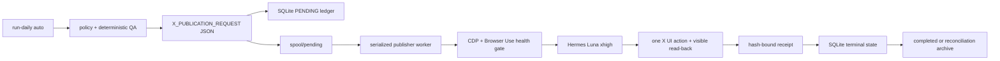

# V2 Persistent Hermes/Browser Use Publisher Plan

## Decision

Use a single serialized publisher worker as the only write boundary. The daily
discovery run remains responsible for XActions read-only discovery, Codex
analysis/generation/evaluation, deterministic QA, policy evaluation, and
request creation. It does not start Hermes in worker mode. It atomically writes
the exact `X_PUBLICATION_REQUEST` JSON to the worker spool. A long-lived Hermes
worker claims one request at a time, verifies the SQLite ledger and request
hashes, checks the owned Browser Use/CDP runtime, calls Hermes with
`gpt-5.6-luna`/`xhigh`, and stores an immutable receipt before archiving the
request.

This directly addresses the two observed failure classes: stale CDP endpoints
and Hermes loops that outlive the caller. The worker owns one lock, one queue,
one action at a time, one lease token, and one explicit health gate. Unknown
outcomes become `RECONCILIATION_REQUIRED`; they are never automatically retried.

## Scope and non-goals

- In scope: Chrome Default/`@nullquanty` runtime binding, Browser Use/CDP
  readiness, queueing, SQLite ownership, receipts, safe process boundaries,
  cron-compatible commands, and tests.
- Out of scope: paid X API, direct XActions write tools, Comet, automatic
  historical reconciliation, or inventing a permalink when read-back is
  ambiguous.
- The worker never receives cookies, `auth_token`, `ct0`, or bearer tokens in
  JSON, argv, prompts, or logs. Chrome authentication stays in the owner-managed
  profile/runtime.

## Implemented control flow



## Queue and lease contract

The SQLite ledger is authoritative. A worker can claim only `PENDING` work and
receives an owner token, lease expiry, dispatch timestamp, and attempt count.
The receipt write and terminal request transition are one SQLite transaction.
The spool file is an audit/transport artifact, not an authority. A request file
whose action/request hashes do not match the ledger is quarantined and stops the
drain. `PUBLISHED`, `FAILED`, and `RECONCILIATION_REQUIRED` files are archived;
they are never selected again.

Existing `CLAIMED` and `RECONCILIATION_REQUIRED` records are historical unknowns.
They are not replayed by this worker. Reconciliation, if needed, must import a
real X permalink/provider ID through a separately reviewed command.

## Browser runtime contract

`config/daily-v2.json` selects `browser-use`, Chrome profile `Default`, and the
expected account `nullquanty`. Worker mode requires health checking. Supply the
current owned CDP WebSocket endpoint through `XGE_CDP_WS` (the loader injects it
into the config without printing it). The health gate checks `/json/version`
and the Browser Use binary before any write request, then runs a read-only
`page_info()` check that must identify `nullquanty`. The worker passes the
endpoint through `BU_CDP_WS` and a worker-scoped `BU_NAME`; it does not use
global `agent-browser close --all` cleanup or broad process matching.

The runtime must be provisioned once per host with a persistent Chrome process
using the authenticated Default profile and a stable CDP endpoint. If the
endpoint is stale, missing, or attached to another account, the worker stops
before Hermes and records no publication attempt.

## Hermes contract

Hermes receives the exact request path and exact request identity fields. The
`x-growth-publisher` skill requires one browser call, one exact action, visible
read-back, and one JSON receipt. The engine validates request hash, action hash,
account binding, canonical `https://x.com/nullquanty/status/<numeric-id>`
permalink, and provider ID. A timeout, tool loop, missing receipt, account
mismatch, or read-back ambiguity is reconciliation-required.

## Rollout

1. `npm run check` and `npm test` in a writable checkout.
2. Set `XGE_CDP_WS` to the live owned endpoint and run:

   ```bash
   npm run daily -- doctor --auto --config config/daily-v2.json
   ```

3. Run one dry discovery to inspect request JSON; dry-run never starts Hermes.
4. Start the serialized worker in drain mode for one canary:

   ```bash
   npm run publisher -- drain --config config/daily-v2.json
   ```

5. Require one verified `PUBLISHED` receipt, provider ID, and permalink. Run
   three consecutive canary cycles before adding the owner's cron entry:

   ```bash
   npm run publisher -- watch --config config/daily-v2.json
   ```

6. Keep one scheduler owner. A cron job may invoke `daily auto` and a separate
   long-lived worker, but it must not run parallel publisher workers.

## Definition of done

- V1 tests and V2 policy/quality tests pass.
- `daily auto` in worker mode queues requests and never invokes Hermes inline.
- Concurrent workers serialize through the lock and DB lease.
- Tampered/missing spool files stop safely and are quarantined.
- A timeout or uncertain Hermes result is terminal reconciliation-required and
  cannot be retried by normal drain.
- Browser/CDP health, profile, account, model, toolset, and receipt checks are
  observable and fail closed.
- Every verified publication has a durable, hash-bound receipt and canonical X
  permalink.
- Cron is documented but remains an operator-owned deployment decision.
